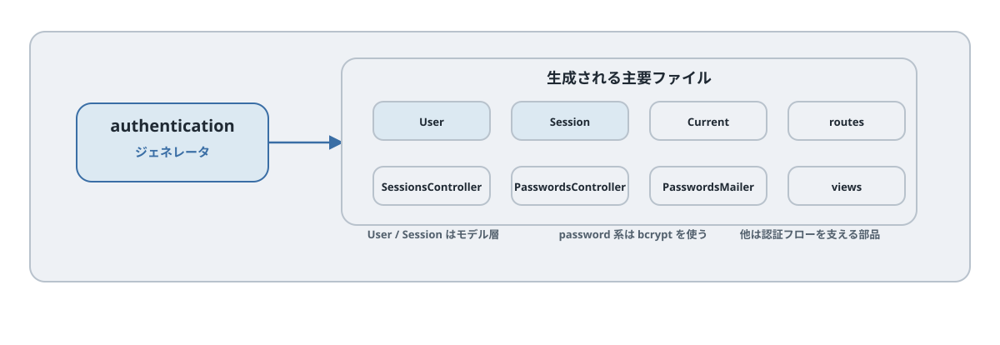

# 第5章 Rails アプリを作成する

## この章のねらい

第4章で決めた Relay の仕様を、実際の Rails アプリとして作ります。この章のゴールは、Hotwire のカスタマイズを一切していない「素の Rails アプリ」を、通常の CRUD が動く状態まで用意することです。

ここで作る状態が、第3部以降の出発点になります。最初は Rails が標準で有効にする Turbo Drive だけで始めるのは、「普通の Rails アプリのどこを、なぜ Hotwire で置き換えるのか」を後の章で実感するためです。

この章では、特に次の 3 点を固定します。

1. Rails 8 標準の認証ジェネレータの実行結果
2. `Project` / `Task` の CRUD と、`Comment` / `Tag` / `Tagging` をモデルだけに留める線引き
3. importmap を前提にした JavaScript 構成

> サンプルの固定環境は Ruby 3.3.5、Rails 8.1.3、turbo-rails 2.0.23、stimulus-rails 1.3.4、importmap-rails 2.2.3 です。すべての Rails 8 系で動作確認したという意味ではありません。Gemfile.lock を保存し、更新時はテストを再実行してください。

## 5.1 Rails アプリの作成

アプリを作成します。

```bash
gem install rails -v 8.1.3
rails _8.1.3_ new relay
cd relay
```

Rails 8 では、`rails new` の既定構成に本書で必要なものがそろっています。

- データベースは SQLite（学習用としてはこのままで十分です）
- JavaScript は import maps（ビルド工程が不要。Rails の既定です）
- Hotwire（`turbo-rails` と `stimulus-rails`）が `Gemfile` に最初から入っている

これらは生成されたアプリの実物で確認できます。`Gemfile` に `turbo-rails` と `stimulus-rails` が含まれ、`config/importmap.rb` と `app/javascript/application.js` が生成されています。中身の読み解きは第6章で行いますが、ここでは「追加のオプションを付けなくても、Hotwire を学ぶ準備が整っている」とだけ押さえれば十分です。

スタイルについては、本書は特定の CSS フレームワークに依存しません。見た目は最小限に留め、Hotwire の挙動に集中します。

サーバーを起動して、初期画面が出ることを確認します。

```bash
bin/rails server
```

ブラウザで `http://localhost:3000` を開き、Rails の初期ページが表示されれば成功です。

## 5.2 認証の追加




Relay では、担当者・コメント投稿者・リアルタイム更新の配信範囲を決めるために ログイン中のユーザーを表す `Current.user` が必要です。そこで、Rails 8 標準の認証ジェネレータを使います。

```bash
bin/rails generate authentication
bin/rails db:migrate
```

このジェネレータは、`User` と `Session` を中心に、認証に必要な一式（コントローラ・ビュー・ルーティング・マイグレーション・`bcrypt` の導入）をまとめて生成します。これで、認証（ログイン・ログアウト）とパスワード再設定の土台が入ります。ただし、パスワード再設定メールを実際に届けるには、別途メール送信（Action Mailer）の設定が必要です。本書ではメール配信そのものは扱わず、ログインを使います。

ここで 1 つ、初級者がつまずきやすい点があります。<strong>このジェネレータが作るのはログイン機能であって、サインアップ（ユーザー登録）画面ではありません。</strong>本書では、ユーザーは後述の seed データで作成し、その認証情報でログインします。

次に、第4章で決めたとおり `User` に `name` を追加します。生成直後の `User` は `email_address` と `password_digest` を持ちますが、`name` は持たないためです。

```bash
bin/rails generate migration AddNameToUsers name:string
bin/rails db:migrate
```

## 5.3 通常 CRUD の生成（`Project` と `Task`）

`Project` と `Task` は、ユーザーが画面から操作するリソースです。CRUD 画面ごと作るため、scaffold を使います。

```bash
bin/rails generate scaffold Project name:string description:text
bin/rails generate scaffold Task project:references title:string description:text status:integer due_on:date assignee:references
```

ここで、2 つの参照の扱いが違う点に注意します。`project` は「タスクは必ずどれかのプロジェクトに属する」ため、必須の参照のままで構いません。一方 `assignee` は「担当者は未割り当てもありうる」うえに、`assignees` テーブルではなく `User` を指す必要があります。

そこで `assignee` の参照だけを直します。生成されたマイグレーションは、そのままでは `assignees` テーブルを参照しようとし、かつ必須になります。`User` を参照し、未割り当てを許すように直します。

`db/migrate/xxxxxx_create_tasks.rb`（該当行を修正）

```ruby
      t.references :assignee, null: true, foreign_key: { to_table: :users }
```

マイグレーションを実行します。

```bash
bin/rails db:migrate
```

生成はできました。5.5・5.6 の関連・enum・フォーム・ルートの調整まで済ませてから CRUD を確認します。scaffold が生成したビューは、Rails 8 では最初から Turbo に対応した形になっています。この事実は 5.11 で確認します。

## 5.4 `Comment` / `Tag` / `Tagging` はモデルだけ用意する

`Comment`・`Tag`・`Tagging` は、第4章で「入れるが UI は後の章で作る」と決めたものです。ここでは scaffold ではなく `model` ジェネレータを使い、<strong>モデルとマイグレーションだけ</strong>を作ります。コントローラもビューも作りません。

```bash
bin/rails generate model Comment task:references user:references body:text
bin/rails generate model Tag name:string
bin/rails generate model Tagging task:references tag:references
bin/rails db:migrate
```

関連を書き加えます。

`app/models/comment.rb`

```ruby
class Comment < ApplicationRecord
  belongs_to :task
  belongs_to :user

  validates :body, presence: true
end
```

`app/models/tag.rb` と `app/models/tagging.rb`

```ruby
class Tag < ApplicationRecord
  has_many :taggings, dependent: :destroy
  has_many :tasks, through: :taggings
end

class Tagging < ApplicationRecord
  belongs_to :task
  belongs_to :tag
end
```

ここで UI を作り込まないのは、意図的な線引きです。コメントは第16章（Turbo Streams）で、タグは第23章（検索と絞り込み）で、それぞれ「必要になったから足す」形で UI を作ります。そうすることで、各機能を使う動機が明確になります。

## 5.5 生成したモデルへ関連を追加する

第4章のモデル構成に沿って、Relay のモデルを作ります。ここでポイントになるのが、<strong>CRUD 画面まで作るモデルと、モデルだけ用意するモデルを分ける</strong>ことです。5.3 と 5.4 で生成したファイルへ、以下を反映します。

まず、各モデルの関連を確認しておきます。生成後に、次の関連を各モデルへ書き加えます。

`app/models/project.rb`

```ruby
class Project < ApplicationRecord
  has_many :tasks, dependent: :destroy
end
```

`app/models/task.rb`

```ruby
class Task < ApplicationRecord
  belongs_to :project
  belongs_to :assignee, class_name: "User", optional: true
  has_many :comments, dependent: :destroy
  has_many :taggings, dependent: :destroy
  has_many :tags, through: :taggings

  enum :status, { todo: 0, in_progress: 1, done: 2 }, default: :todo, validate: true

  validates :title, presence: true
end
```

`status` は第4章で決めたとおり enum にします。`todo` / `in_progress` / `done` の 3 状態が、後の検索・絞り込み・バリデーション・通知すべての軸になります。担当者（`assignee`）は未割り当てを許すため `optional: true` にします。

`User` にも、担当しているタスクとコメントの関連を加えます。認証ジェネレータが生成した行はそのまま残し、クラスの中に次の 2 行を追記します。

`app/models/user.rb`

```ruby
class User < ApplicationRecord
  # 認証ジェネレータが生成した内容（has_secure_password など）はそのまま残します

  # ↓ 次の 2 行を追記します
  has_many :assigned_tasks, class_name: "Task", foreign_key: :assignee_id, dependent: :nullify
  has_many :comments, dependent: :destroy
end
```

## 5.6 ルートとフォームを整える

`config/routes.rb` の `Rails.application.routes.draw` 内に `root "tasks#index"` を加えます。認証後の戻り先に必要です。タスク一覧の見出しは「タスク」にします。

scaffold の `_form.html.erb` では、整数の status 欄を次の選択欄に置き換えます。enum へ送るのは `"todo"` などのキーで、文字列 `"0"` ではありません。

```erb
<%= form.label :status, "ステータス" %>
<%= form.select :status, Task.statuses.keys %>
```

プロジェクト・担当者の ID 入力も `collection_select` に置き換えます。後続章とラベルを揃え、タイトルは「タイトル」、送信ボタンは「保存」にします。完成したフォームは第25章に掲載します。

```erb
<%= form.label :project_id, "プロジェクト" %>
<%= form.collection_select :project_id, Project.order(:name), :id, :name %>
<%= form.label :assignee_id, "担当者" %>
<%= form.collection_select :assignee_id, User.order(:name), :id, :name, include_blank: "未割り当て" %>
```

レイアウトには、`authenticated?` で判定したログアウトボタンを追加します。Rails 標準認証に `current_user` ヘルパーはありません。

```erb
<% if authenticated? %>
  <%= button_to "ログアウト", session_path, method: :delete %>
<% end %>
<div id="flash" role="status"><%= render "layouts/flash" %></div>
```

scaffold の各ページにある notice の表示は削除し、フラッシュをレイアウトに集約します。`app/views/layouts/_flash.html.erb` を作成します。

```erb
<% flash.each do |type, message| %>
  <div class="flash <%= type %>" data-turbo-temporary><%= message %></div>
<% end %>
```

一覧に置く新規フォームのため、後の章で `index` を書き換える際も `@task = Task.new` を残します。

## 5.7 seed データ

検索やページネーションを後の章で体感するには、ある程度の件数が必要です。seed データを用意します。ログイン用のユーザーも、ここで作ります。

seed は、何度実行しても件数が増殖しないように書きます。先頭でドメインデータを消してから作り直し、ログイン用のユーザーは `find_or_create_by!` で重複を避けます。既存ユーザーのパスワードは変更しません。すでに同じメールのユーザーがいる場合は、そのパスワードでログインします。乱数・日付・採番 ID は実行ごとに変わるため、データの完全再現を保証する seed ではありません。既存のタスクを消すので、学習用データベースでだけ実行してください。

`db/seeds.rb`

```ruby
# 再実行できるように、ドメインデータを子から順に消してから作り直します
[Tagging, Comment, Task, Tag, Project].each(&:delete_all)

user = User.find_or_create_by!(email_address: "alice@example.com") do |u|
  u.name = "Alice"
  u.password = "password"
end

tags = %w[bug feature chore urgent].map { |name| Tag.create!(name: name) }

3.times do |i|
  project = Project.create!(name: "プロジェクト #{i + 1}", description: "サンプルプロジェクトです。")

  50.times do |n|
    task = project.tasks.create!(
      title: "タスク #{i + 1}-#{n + 1}",
      description: "サンプルのタスクです。",
      status: Task.statuses.keys.sample,
      assignee: [user, nil].sample,
      due_on: Date.current + rand(0..30)
    )
    task.tags << tags.sample(rand(0..2))
    task.comments.create!(user: user, body: "最初のコメントです。") if n.even?
  end
end
```

投入します。

```bash
bin/rails db:seed
```

これで、プロジェクト 3 件・タスク約 150 件・数種のタグ・散在するコメントが入ります。ページネーション（第24章）や検索（第23章）を体感できる件数です。

## 5.8 認証付き System Test の準備

認証ジェネレータを使うと、未ログインのテストはログイン画面へ転送されます。`test/fixtures/users.yml` の各ユーザーに `name` を追加し、パスワードのダイジェストを `BCrypt::Password.create("password")` で作ってください。

共通基底クラスでログインと `dom_id` を用意します。生成済みのファイルを次の内容へ置き換えます。

`test/application_system_test_case.rb`

```ruby
require "test_helper"

class ApplicationSystemTestCase < ActionDispatch::SystemTestCase
  include ActionView::RecordIdentifier
  driven_by :selenium, using: :headless_chrome, screen_size: [1200, 1000]

  setup do
    visit new_session_path
    fill_in "email_address", with: users(:one).email_address
    fill_in "password", with: "password"
    click_on "Sign in"
    assert_current_path root_path
  end
end
```

最初の確認には次のテストを `test/system/projects_test.rb` に書きます。生成済みの同名ファイルがあれば置き換えます。

```ruby
require "application_system_test_case"

class ProjectsTest < ApplicationSystemTestCase
  test "ログイン後にプロジェクト一覧を表示する" do
    visit projects_path
    assert_selector "h1", text: "Projects"
  end
end
```

この基底クラスの setup は、各テストの setup より前に実行されます。個別テストにログインを重複して書く必要はありません。第5章の時点で一覧見出しも「タスク」に変更します。実行には Chrome が必要です。

```bash
bin/rails test:system
```

scaffold が作るリクエストテストにも `setup` 内で `sign_in_as users(:one)` を追加します。これは認証ジェネレータの `SessionTestHelper` を使うサーバー側のログインです。ブラウザのログインとは別の方法です。

## 5.9 最初の動作確認

ここまでの状態を、ブラウザで通して確認します。

1. `bin/rails server` でサーバーを起動する
2. `http://localhost:3000/session/new` を開き、`alice@example.com` / `password` でログインする
3. `http://localhost:3000/projects` でプロジェクト一覧を見る
4. プロジェクトを作成・編集・削除する
5. タスクを作成し、無効な入力（タイトル空）でバリデーションエラーが出ることを確認する

この時点では、まだ Hotwire のカスタマイズを何もしていません。それでも、画面遷移やフォーム送信は動きます。

## 5.10 各部のハンズオンで使うテスト方針

本書では、主要な操作に System Test を用意し、各章では確認すべき振る舞いを示します。すべての章にテストコードを掲載する構成ではありません。たとえば、インライン編集（第12章）、Turbo Streams での作成・削除（第16章）、検索（第23章）などです。

これらの小さなテストは、第8部「Hotwire アプリを保守する」で、テスト戦略として束ね直します。章の途中の UI と完成版ではラベルや構造が変わります。第28章で完成版のテストへ置き換えます。

## 5.11 通常 CRUD の時点で Turbo Drive が効いていることを確認する

最後に、重要な事実を確認します。<strong>ここまでで作った素の CRUD は、すでに Turbo Drive 経由で動いています。</strong>

Rails 8 では、`rails new` の時点で `turbo-rails` が読み込まれます。`app/javascript/application.js` を見ると、次のように Turbo が読み込まれているはずです。

`app/javascript/application.js`

```javascript
import "@hotwired/turbo-rails"
import "controllers"
```

ブラウザの DevTools を開き、Network タブを見ながらプロジェクト一覧のリンクをたどってみてください。ページ全体が再読み込みされず、必要な部分だけが差し替わっていることがわかります。これが Turbo Drive の働きです。

このことは、第3部の理解にとって大切です。第3部「Turbo Drive」は、新しい機能を足す章ではなく、<strong>すでに動いている仕組みを理解し、契約どおりに整える章</strong>です。その出発点が、いまできあがりました。

> この章で作った Relay は、これ以降のすべての章の土台です。モデル名・`status` の値・「コメントとタグの UI は後で作る」という線引きは、後の章で繰り返し前提になります。

## 参考資料

- Rails Guides: <https://guides.rubyonrails.org/>
- Rails ガイド「テスティング」: <https://guides.rubyonrails.org/testing.html>
- Rails ガイド「Active Record の関連付け」: <https://guides.rubyonrails.org/association_basics.html>
- Rails セキュリティガイド（認証）: <https://guides.rubyonrails.org/security.html>
