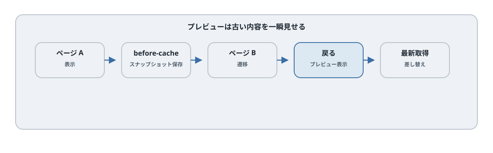
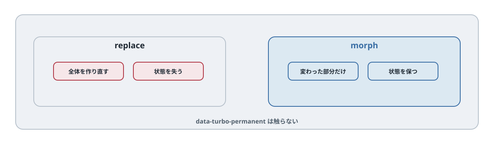

# 第9章 キャッシュ、プレビュー、リロード、morphing

## この章のねらい

第7章で、visit には 2 種類あると触れました。リンクで進む application visit と、戻る・進むで起きる restoration visit です。この章では、restoration visit を支える<strong>キャッシュ</strong>と、それが引き起こす意図しない表示を扱います。

そのうえで、Turbo 8 から入った<strong>morphing</strong>を学びます。これは「差し替え方」そのものを変える仕組みで、第5部のリアルタイム更新（第18章）にもつながります。

この章は 2 つに分かれます。前半（キャッシュ系）は「差し替えを速く見せる」話、後半（morphing 系）は「差し替え方を変える」話です。

## 9.1 snapshot cache

Turbo Drive は、訪れたページを<strong>スナップショット</strong>として覚えています。これを snapshot cache と呼びます。

ページから離れる直前に、Turbo はそのページの状態を 1 枚のスナップショットとして保存します。あとで戻る・進むの操作（restoration visit）をしたとき、利用可能なスナップショットがあれば復元します。キャッシュがなければサーバーから取得します。restoration visit では、復元後に必ず最新 HTML を取得するわけではありません。

従来のページ遷移では、戻るときも毎回サーバーへ取りに行くことがありました。Turbo は、一度見たページをスナップショットで持っておくことで、戻る操作を速くします。

## 9.2 preview 表示




snapshot cache は、戻る操作だけでなく、前に見たページへ進むときにも使われます。これが <strong>preview（プレビュー）</strong>です。

リンクなどによる application visit でキャッシュ済みのページへ進むと、Turbo はまずキャッシュ版を即座に表示します。これがプレビューです。同時に、裏で最新の内容をサーバーから取得し、届いたら本物に差し替えます。

つまり、ユーザーには「一瞬で表示された」ように見えますが、最初に見えているのは少し古いキャッシュかもしれません。プレビュー表示中は、`<html>` に `data-turbo-preview` という属性が付くので、DevTools で見分けられます。

この仕組みは速さを生む一方で、問題も生みます。たとえば、古い件数や古いフラッシュメッセージが、一瞬だけプレビューに表示されることがあります。これを防ぐ手段が、次に見る `data-turbo-temporary` と meta タグです。

## 9.3 `data-turbo-temporary` とキャッシュ制御

プレビューに古い内容を出したくない要素には、`data-turbo-temporary` を付けます。

たとえば、フラッシュメッセージのように「一度きりで、次に出てほしくない」要素に付けます。

```erb
<div data-turbo-temporary>
  <%= notice %>
</div>
```

`data-turbo-temporary` が付いた要素は、ページがキャッシュに保存される前に、Turbo が自動で取り除きます。だから、プレビューにその要素が出ることはありません。フラッシュメッセージが、戻ったときに一瞬よみがえる、という不自然さを防げます。

ページ単位で止めたいときは、そのページの `<head>` に meta タグを置きます。値は用途で 2 つに分かれます。

```erb
<meta name="turbo-cache-control" content="no-cache">
```

`no-cache` は、そのページをキャッシュしません。戻る操作（restoration visit）でも、毎回サーバーへ取りに行きます。

```erb
<meta name="turbo-cache-control" content="no-preview">
```

`no-preview` は、戻る操作のためのキャッシュは残しつつ、プレビューとしての表示だけを止めます。「戻る操作は速いままにしたいが、古い内容をプレビューで見せたくない」場合に向きます。

## 9.4 `data-turbo-track` の再確認

第7章で見た `data-turbo-track="reload"` も、ここで関わります。これは「アセット（CSS など）が変わったら、body だけの差し替えをやめてフルリロードする」仕組みでした。

キャッシュ・プレビューと合わせて整理すると、Turbo Drive は次のように振る舞います。

- 普段は、visit で body だけを差し替える（速い）
- 前に見たページは、プレビューで即座に見せる（さらに速い）
- ただし、追跡対象のアセットが変わったときは、フルリロードする（安全）

速さと安全さを、状況に応じて自動で切り替えているわけです。

## 9.5 キャッシュと Stimulus の関係

キャッシュは、Stimulus（第6部で扱う JavaScript の仕組み）と関わります。ここでは関係だけ押さえます。

ページがキャッシュに保存される直前、Turbo は `turbo:before-cache` というイベントを発火します。また、要素が取り除かれると Stimulus のコントローラは切断（disconnect）され、新しい要素が接続されると connect が呼ばれます。要素が残る morph では再接続されない場合があります。

ここで注意が要ります。スナップショットは「その瞬間の DOM」をそのまま保存します。もし JavaScript で一時的に書き換えた状態（開いたメニュー、初期化済みの外部ライブラリなど）が残っていると、それごとキャッシュされ、プレビューで再現されてしまいます。

そのため、`turbo:before-cache` のタイミングで一時的な状態を元に戻す、外部ライブラリは disconnect で後始末する、といった対応が必要になります。具体的な書き方は[第22章](../part6/chapter22.md)（外部ライブラリとの連携）で扱います。

## 9.6 Turbo 8 の page refresh と morph




ここから後半です。視点が変わります。前半は「差し替えを速く見せる」話でした。後半は「差し替え方そのものを変える」話です。

Turbo 8 では、<strong>page refresh</strong>という考え方が加わりました。いまいる URL と同じ URL へ visit したとき、Turbo はそれを「ページの再描画」として扱えます。たとえば、フォーム送信のあと同じ一覧ページへ戻る場合などです。

既定では、page refresh もこれまでどおり body をまるごと差し替えます。これを <strong>morph（モーフィング）</strong>に切り替えると、差し替え方が変わります。

morph は、新しい HTML と現在の DOM を比べ、<strong>変わった部分だけを書き換えます</strong>。全体を捨てて作り直すのではなく、差分を当てる形です。これにより、再利用できる要素のフォーカスなどを維持しやすくなります。ただし未保存の入力が必ず守られるわけではありません。スクロールの維持には、別に `turbo-refresh-scroll="preserve"` の設定が必要です。

たとえば Relay のタスクボードで、1 件のステータスが変わったとき。body 全体の差し替えだと、見ていた位置やフォーカスが飛びます。morph は新しい HTML に合わせて必要な箇所を更新します。保持対象の要素と入力保護、スクロールの設定は別に設計します。

## 9.7 `turbo-refresh-method`

morph を有効にするには、レイアウトの `<head>` に次の meta タグを置きます。

```html
<meta name="turbo-refresh-method" content="morph">
```

`content` には `morph` か `replace` を指定します。<strong>既定は `replace`</strong>（全体の差し替え）です。`morph` にすると、page refresh のときに差分だけを当てる morph になります。

## 9.8 `turbo-refresh-scroll`

morph と一緒に使うのが、スクロール位置の扱いです。

```html
<meta name="turbo-refresh-scroll" content="preserve">
```

`content` には `preserve` か `reset` を指定します。<strong>既定は `reset`</strong>（先頭に戻す）です。`preserve` にすると、page refresh の前後でスクロール位置が保たれます。長い一覧の途中で更新がかかっても、見ていた位置から動きません。

## 9.9 `data-turbo-permanent` と morph の関係

morph でも「絶対に触ってほしくない要素」があります。たとえば、再生中の動画プレーヤーや、開いたままにしておきたいメニューです。

そうした要素には、`data-turbo-permanent` を付け、`id` を与えます。

```html
<div id="player" data-turbo-permanent>
  <!-- 再生中のプレーヤーなど -->
</div>
```

通常のページ遷移では、旧ページと新ページの双方に、同じ一意の `id` と `data-turbo-permanent` を持つ要素がある場合に保持されます。新ページに対応する要素がない場合は保持されません。morph の対象からも外れるため、差し替えや差分適用で壊されません。

## 9.10 `turbo-stream action="refresh"` と broadcast refresh

page refresh は、Turbo Streams からも起こせます。第15章で扱う Turbo Streams の `refresh` アクションです。

```html
<turbo-stream action="refresh" method="morph" scroll="preserve"></turbo-stream>
```

この stream を受け取ると、ブラウザは page refresh を行います。`method="morph"` と `scroll="preserve"` を付ければ、9.7・9.8 と同じく morph・スクロール保持で再描画できます。

これがリアルタイム更新で活きます。あるユーザーの操作をきっかけに、サーバーが「このページを refresh してください」という stream を全員へ配信すれば、各自の画面が morph で最新化されます。細かい差分を 1 つずつ broadcast しなくても、「最新の状態に揃える」ことができます。この broadcast refresh は、第18章（Action Cable でのリアルタイム更新）で扱います。

> ここまでで、Turbo Drive を「visit」という 1 つの軸で読み解き、フォーム送信の契約、キャッシュ・プレビュー、morph まで見ました。次の [第10章](chapter10.md) では、visit の前後に割り込むイベントの制御を扱い、第3部を締めます。

## 9.11 バージョンと更新の範囲

`refresh` stream の `method` / `scroll` 属性は Turbo **8.0.21 以降**の機能です。Turbo 8 の初期版では、head の meta タグで指定します。バージョンは Gem の番号と JavaScript の番号を区別して確認します。

`data-turbo-track="reload"` は、head の追跡対象タグの HTML（指紋付き URL や importmap の内容など）を比較します。同じ URL の CSS ファイル本文を比較する仕組みではありません。`javascript_importmap_tags` が生成する importmap も追跡対象です。

morph や `update` で Stimulus のルート要素が残れば、そのコントローラは再接続されません。接続と切断は DOM 上の接続状態で決まり、サーバーから応答を受けた回数とは一致しません。

## 参考資料

- Turbo Drive（Handbook）: <https://turbo.hotwired.dev/handbook/drive>
- Page Refreshes と morphing（Handbook）: <https://turbo.hotwired.dev/handbook/page_refreshes>
- Turbo の属性リファレンス: <https://turbo.hotwired.dev/reference/attributes>
