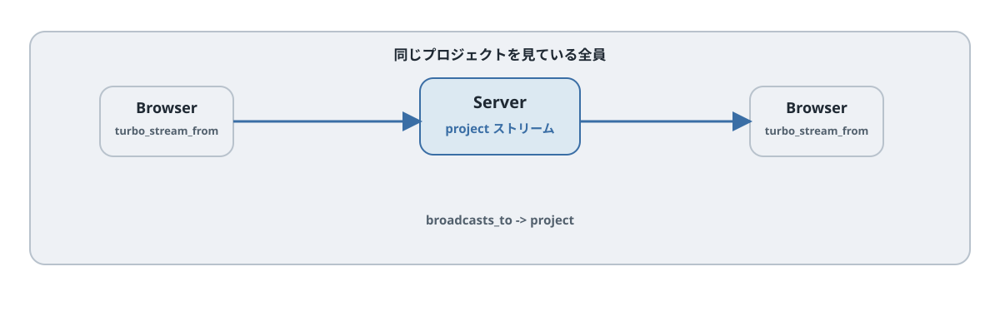

# 第18章 Action Cable でリアルタイム更新する

## この章のねらい

第16章と[第17章](chapter17.md)では、「自分の操作」をきっかけに画面を更新しました。フォームを送信した本人の画面が、ページ遷移なしで変わる仕組みです。

この章では、それを「他のユーザーの操作」へ広げます。あるユーザーがタスクを追加したら、同じプロジェクトを見ている全員の画面に、そのタスクがリアルタイムで現れる、という形です。

仕組みの土台は同じです。サーバーが Turbo Streams の命令を送り、ブラウザがそれを実行します。違うのは、命令を届ける経路です。これまではフォーム送信の応答でしたが、今回は Action Cable を通じて、購読している全員へ配信（broadcast）します。

## 18.1 条件のないプロジェクト一覧で仕組みを試す

リアルタイム更新を受け取るには、まず画面が「どの配信を聞くか」を宣言します。`turbo_stream_from` を使います。

`app/views/projects/tasks_panel.html.erb`（独立した実験用。完成版には適用しません）

```erb
<%= turbo_stream_from @project %>
```

`turbo_stream_from @project` は、`<turbo-cable-stream-source>` という要素を描き、`@project` に対応する配信を Action Cable で購読し始めます。この宣言を置いたページは、`@project` 宛てに broadcast された Turbo Streams の命令を受け取り、そのまま実行します。

受け取る命令の中身は、[第15章](chapter15.md)〜[第17章](chapter17.md)で見たものと同じ「差し替え命令の入った HTML」です。経路が Action Cable に変わっただけで、ブラウザのやることは変わりません。

## 18.2 実験用の model callback と broadcast

次に、配信する側です。タスクが作成・更新・削除されたら、その内容を `@project` 宛てに配信します。これはモデルに宣言できます。

`app/models/task.rb`（追記）

```ruby
class Task < ApplicationRecord
  belongs_to :project
  # ... 既存の関連やバリデーション ...

  broadcasts_to ->(task) { task.project }, inserts_by: :prepend
end
```

`broadcasts_to` は、レコードの作成・更新・削除のたびに、Turbo Streams を自動で配信します。配信先（streamable）は、ラムダが返すもの（ここでは `task.project`）です。18.1 で `turbo_stream_from @project` を宣言したページが、これを受け取ります。

既定では、作成で append、更新で replace、削除で remove が配信されます。ここでは `inserts_by: :prepend` を指定し、第16章と同じく一覧の先頭へ追加するようにしています。配信される HTML は、サーバー側で `_task` partial を描いたものです。

この例は、対象プロジェクトの全件を `id="tasks"` に表示する読み取り専用の画面でだけ試します。検索、ページ分割、インライン編集と併用しません。`@project` は `ProjectsController#tasks_panel` で取得済みです。タスクの所属変更は元の配信先に remove を送らないため、この実験では禁止します。完成版では次の方式へ置き換えます。




## 18.3 コントローラからの broadcast

モデルの callback は「1 レコードの変化」を配信するのに向いています。しかし、[第17章](chapter17.md)で見た件数バッジのように、レコード自体ではない部分も、他のユーザーへ更新したいことがあります。

そうした場合は、コントローラなどから明示的に broadcast します。

```ruby
Turbo::StreamsChannel.broadcast_update_to(
  @project, target: "task_count", html: @project.tasks.size
)
```

`broadcast_update_to` は、`@project` を購読している全員へ、「`id="task_count"` を、この内容に update せよ」という命令を配信します。`broadcast_append_to` や `broadcast_replace_to` など、第15章の各 action に対応したメソッドがあります。

自分の操作の応答（第16・17章）では、件数も flash も同じレスポンスにまとめて返していました。リアルタイム配信では、行は model callback、件数はコントローラからの broadcast、というように、配信したいものごとに送る形になります。

## 18.4 配信範囲の設計

ここで大切なのが、「誰に届くか」です。届く範囲は、<strong>配信先（streamable）と購読先が一致した相手</strong>です。`turbo_stream_from @project` を宣言した人だけが、`@project` 宛ての配信を受け取ります。

だから、配信先を何にするかが設計の要です。プロジェクト単位で見せたい更新なら、`@project` を配信先にします。これを、たとえば「全プロジェクト共通」のような広すぎる配信先にすると、関係のないユーザーにまで更新が飛びます。無駄な通信が増えるうえ、見せるべきでない情報が混ざる危険もあります。

「この更新は、誰に届くべきか」を先に決め、それに合った streamable を選ぶ。これが配信範囲の設計です。

## 18.5 認可の入口

配信範囲と認可は、別の話です。混同しないでください。

`turbo_stream_from @project` が生成する購読名は、署名されています。これは購読名の改ざんを防ぐもので、第三者が勝手に別の配信を聞き取ることを難しくします。しかし、これは<strong>認可ではありません</strong>。「そのユーザーが、そのプロジェクトを見てよいか」を判断しているわけではないからです。

アクセス制御は、別途コントローラやモデルの側で行います。たとえば「ログイン済みか」「そのプロジェクトのメンバーか」を確認し、見てよいユーザーにだけ `turbo_stream_from` を描く、配信する内容に秘密情報を含めない、といった対策です。

本書のサンプル Relay は単一チーム前提なので、ここは最小限に留めます。Hotwire の部分更新・broadcast でも認可を崩さない設計は、[第31章](../part8/chapter31.md)でまとめて扱います。

## 18.6 実務での注意点

リアルタイム更新は強力ですが、いくつか注意点があります。

- <strong>配信のたびに HTML を描く</strong>。broadcast は partial をサーバーで描画します。保存のたびに重い描画が走ると、レスポンスが遅くなります。broadcast の各 action には、裏のジョブで描く非同期版（`broadcast_append_later_to` や `broadcast_replace_later_to` などの `*_later` 系）があるので、重い配信はそちらに逃がします（`broadcasts_to` も内部でこれらを使います）。
- <strong>N+1 に注意</strong>。配信用の partial でも、関連を引けば N+1 が起きます。これは第30章で扱います。
- <strong>細かすぎる配信を見直す</strong>。変化のたびに細かい命令を配信すると、数が増えます。「とにかく最新に揃えたい」だけなら、第15章の `refresh` を使った broadcast refresh が向きます。サーバーが「このページを refresh して」と配信すると、各自の画面が morph（第9章）で最新化されます。
- <strong>1 件ずつの保存では callback が走る</strong>。`broadcasts_to` はレコードの保存（`save` / `destroy`）ごとに動くので、seed で 1 件ずつ作るときにも配信が走ります。一方、`update_all` / `delete_all` のような SQL の一括更新は callback を通らないので、配信されません。「配信してほしいのに飛ばない」「飛んでほしくないのに飛ぶ」のどちらの取りこぼしにも注意します。

> 第18章で、第5部を締めます。Turbo Streams を「差し替え命令の入った HTML」として理解し、CRUD への組み込み、複数箇所の同時更新、そして Action Cable による複数ユーザーへの配信まで見ました。次の [第6部](../part6/index.md) では、ここまでサーバー主体で進めてきた更新に対し、サーバーを介さない振る舞いを足す Stimulus を学びます。

## 18.7 完成版では行を配らず変更を通知する

第23・24章と組み合わせる完成版では、18.2 の `broadcasts_to` を削除します。検索条件・ページ・プロジェクトが異なる閲覧者へ同じ行を配ると、表示条件に合わない行が入り、編集中のフォームも消えるためです。

代わりに `after_commit` でデータを含まない変更通知を送ります。所属プロジェクトが変わっても、全閲覧者が自身の条件で再取得するので、移動元・移動先の両方を再評価できます。

```ruby
# Task のクラス内へ追加
 after_commit :announce_change

 private
 def announce_change
   Turbo::StreamsChannel.broadcast_update_to :tasks,
     target: "task_changes", partial: "tasks/change"
 end
```

一覧に `turbo_stream_from :tasks` と `<div id="task_changes"></div>` を置きます。通知を受ける partial と Stimulus は次のとおりです。Stimulus の仕組みは第19〜21章で学びます。ここでは完成版への接続点として読み、実装の置き換えは第23章で行ってください。

`app/views/tasks/_change.html.erb`

```erb
{{#include ../snippets/app/views/tasks/_change.html.erb}}
```
`app/javascript/controllers/task_change_controller.js`

```javascript
{{#include ../snippets/app/javascript/controllers/task_change_controller.js}}
```
`app/javascript/controllers/task_list_controller.js`

```javascript
{{#include ../snippets/app/javascript/controllers/task_list_controller.js}}
```

一覧フレームには `data-task-list-target="frame"`、親には `data-controller="task-list"` と `data-action="tasks:received@document->task-list#changed turbo:frame-load->task-list#loaded"` を付けます。`location` target に表示中の URL、`notice` target に更新通知を持たせます。これらを含むビュー全体は第24章の完成版に掲載します。再取得中に届いた変更通知は保留し、フレームの読み込み完了後にもう一度取得します。編集中・モーダル表示中は自動更新せず、通知と手動更新ボタンを出します。追記型一覧も先頭から読み直す必要があるので手動更新にします。要素を一括で morph すれば未保存入力を守れる、とは仮定しません。

コメントはタスクごとの固定一覧なので、`show` に `turbo_stream_from @task, :comments` を追加し、`Comment` の作成後に append、削除後に remove できます。送信者が HTTP 応答と配信の両方を受けても、partial のルートに一意の `dom_id(comment)` があるため append の同一 ID の扱いで重複を防げます。

`app/models/comment.rb`

```ruby
{{#include ../snippets/app/models/comment.rb}}
```

学習用 Relay はログインした全員が全タスク・コメントを見られる単一チームです。変更通知にはタスク内容を含めません。権限のある製品では第31章の購読失効まで実装してください。

## 18.8 配信を動かす条件

開発用の `async` Action Cable アダプタは同じ Rails プロセス内だけに配信します。別プロセスの Rails console からは届きません。Web 画面から操作するか、複数プロセスで共有できる Solid Cable / Redis を設定します。

`*_later_to` は Active Job の実行環境も必要です。開発で async job を使うなら同一プロセスを起動したままにし、本番の Solid Queue では worker を起動します。この章の完成版の変更通知は同期の `broadcast_update_to` です。

二つのブラウザで試すときは、受信側の `<turbo-cable-stream-source>` に `connected` 属性が付いた後に操作します。配信は履歴の再送ではないため、購読前の変更は受信できません。テストの `test` アダプタは送信内容を記録し、同一プロセスへの配信も扱います。テストランナーと Web サーバーを別プロセスにする構成では、共有可能なアダプタを選びます。

## 参考資料

- Turbo Streams（Handbook）: <https://turbo.hotwired.dev/handbook/streams>
- turbo-rails（Broadcastable / Streams）: <https://github.com/hotwired/turbo-rails>
- Rails ガイド「Action Cable の概要」: <https://guides.rubyonrails.org/action_cable_overview.html>
- Page Refreshes と morphing（Handbook）: <https://turbo.hotwired.dev/handbook/page_refreshes>
