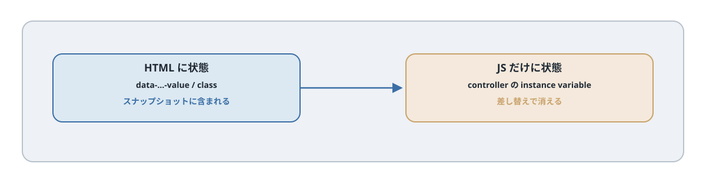

# 第21章 Values / Classes / Outlets

## この章のねらい

第20章で、コントローラ・action・target を覚えました。これで操作に反応できますが、まだ足りないものがあります。

たとえば「3 秒後に消す」というコントローラを作るとき、その「3 秒」をどこに持たせるでしょうか。JavaScript に直接書くと、画面ごとに秒数を変えられません。また、付け外しする CSS クラス名を JavaScript に直書きすると、見た目の都合が JavaScript に漏れます。

この章では、こうした<strong>設定値・クラス名・コントローラ同士の接続</strong>を、HTML 側に持たせる仕組みを学びます。Values・CSS Classes・Outlets です。これは第6部の軸「状態を HTML に置く」の核心です。

## 21.1 Values

Values は、コントローラに渡す設定値です。HTML の data 属性で渡し、コントローラでは型付きで受け取れます。

例として、一定時間で自動的に消えるトースト（第27章で使います）を作ります。

`app/javascript/controllers/toast_controller.js`

```javascript
import { Controller } from "@hotwired/stimulus"

export default class extends Controller {
  static values = { delay: { type: Number, default: 3000 } }

  connect() {
    this.timeout = setTimeout(() => this.element.remove(), this.delayValue)
  }

  disconnect() {
    clearTimeout(this.timeout)
  }
}
```

`static values` で、`delay` という数値の値を宣言します。`default: 3000` は、指定がないときの既定値です。コントローラの中では `this.delayValue` で読めます。

HTML 側では、`data-controller名-値の名前-value` で渡します。

```erb
<div data-controller="toast" data-toast-delay-value="5000">
  保存しました。
</div>
```

これで、このトーストは 5000 ミリ秒（5 秒）で消えます。`data-toast-delay-value` を書かなければ、既定の 3000 ミリ秒です。秒数という設定が、JavaScript ではなく HTML 側にあります。だから、画面ごとに違う秒数を、サーバーの都合で指定できます。

値の型は、`Number` のほか `String`・`Boolean`・`Array`・`Object` が使えます。また、値が変わったときに呼ばれるコールバックもあります。`delay` なら `delayValueChanged()` という名前のメソッドを定義しておくと、値の変化に反応できます。

値の名前が複数語のときは、属性名はハイフン区切りになります。たとえば `refreshInterval` という値なら、属性は `data-toast-refresh-interval-value` です。

## 21.2 CSS Classes

コントローラの中で CSS クラスを付け外しすることはよくあります。このとき、クラス名を JavaScript に直書きすると、見た目の都合が JavaScript に漏れます。CSS Classes を使うと、クラス名も HTML 側に置けます。

開閉するコントローラを例にします。

`app/javascript/controllers/disclosure_controller.js`

```javascript
import { Controller } from "@hotwired/stimulus"

export default class extends Controller {
  static targets = ["content"]
  static classes = ["hidden"]

  toggle() {
    this.contentTarget.classList.toggle(this.hiddenClass)
  }
}
```

`static classes` で `hidden` というクラスを宣言し、`this.hiddenClass` で読みます。実際のクラス名は HTML 側で指定します。

```erb
<div data-controller="disclosure" data-disclosure-hidden-class="d-none">
  <button type="button" data-action="disclosure#toggle">開閉</button>
  <div data-disclosure-target="content">詳細</div>
</div>
```

`data-disclosure-hidden-class="d-none"` で、付け外しするクラスを `d-none` だと指定しています。JavaScript は「`hiddenClass` を付け外しする」としか書いておらず、それが具体的にどのクラスかは HTML（と CSS）の都合です。CSS フレームワークを変えても、JavaScript は直さずに済みます。

## 21.3 Outlets

Outlets は、コントローラから<strong>別のコントローラ</strong>を参照する仕組みです。離れた場所にあるコントローラ同士をつなぎたいときに使います。

たとえば、検索フォームのコントローラから、一覧のコントローラを操作したい、といった場面です（ここでは Outlets 単独の例として扱います。第23章の検索はフォーム送信で実装します）。

```javascript
import { Controller } from "@hotwired/stimulus"

export default class extends Controller {
  static outlets = ["list"]

  refresh() {
    this.listOutlet.reload()
  }
}
```

`static outlets` で `list` を宣言し、HTML 側で CSS セレクタを指定します。

```erb
<div data-controller="search" data-search-list-outlet="#project_tasks">
  ...
</div>

<%= turbo_frame_tag "project_tasks", src: tasks_panel_project_path(@project), data: { controller: "list" } %>
```

ここで大切なのは、`data-search-list-outlet` のセレクタ（`#project_tasks`）が指す要素が、<strong>それ自身 `list` コントローラである</strong>（`data-controller="list"` を持つ）ことです。Outlet は「セレクタで要素を探し、その要素に結びついたコントローラを参照する」仕組みだからです。

`this.listOutlet` で、`#project_tasks` に結びついた `list` コントローラのインスタンスを参照し、そのメソッド（`reload` など）を呼べます。Outlets は強力ですが、コントローラ同士を密に結びつけるので、使いすぎると関係が追いにくくなります。「本当にコントローラ間の連携が要るか」を見極めて使います（Outlets は Stimulus 3.2 以降の機能です）。

## 21.4 状態を持つべきかの判断

Values・Classes・Outlets を学ぶと、コントローラに何でも持たせたくなります。しかし、Stimulus の思想は「状態は HTML に置く」でした。

判断の目安は、こうです。

- 設定値（秒数、URL、上限など）は、Values で HTML に置く
- 付け外しするクラス名は、CSS Classes で HTML に置く
- いまの状態（開いているか、選択中かなど）も、できるだけ DOM に表す（クラスや属性で）
- コントローラのインスタンス変数に状態をため込むのは、最小限にする

コントローラの中（JavaScript のインスタンス変数）に状態をため込むと、Turbo がページや frame を差し替えたときに、その状態は失われます。次の 21.5 で、その理由を見ます。

## 21.5 HTML 側に情報を置く利点




なぜ、状態を HTML に置くのでしょうか。最大の理由は、<strong>Turbo と噛み合うから</strong>です。

第9章で見たとおり、Turbo はページのスナップショットをキャッシュし、復元します。このスナップショットは「そのときの HTML」です。設定値や状態が HTML の data 属性やクラスに表れていれば、それらはスナップショットに含まれ、復元時にもそのまま戻ります。コントローラは、復元された HTML を見て、`connect()` で自分を組み立て直せます。

逆に、状態をコントローラのインスタンス変数だけに持っていると、差し替えや復元のたびに消えます。「さっき開いていたメニューが、戻ったら閉じている」といった不整合が起きます。

HTML 側に情報を置くことは、宣言的で読みやすいだけでなく、Turbo の差し替え・キャッシュに強い、という実利があります。これが、第6部を通じての「状態を HTML に置く」という指針の理由です。

> 第21章では、Values・Classes・Outlets で、設定値・クラス名・コントローラ連携を HTML 側に持たせました。次の第22章では、Stimulus から外部の JavaScript ライブラリを安全に扱う方法を学び、第6部を締めます。

## 21.6 CSS と Outlet の参照先を用意する

`d-none` はブラウザ標準のクラスではありません。`app/assets/stylesheets/application.css` に定義します。

```css
.d-none { display: none !important; }
.skeleton { padding: 1rem; background: #eee; }
```

21.3 の `list.reload()` も Stimulus の組み込みメソッドではありません。次のコントローラを作り、`list` を付ける要素を `src` 付きのフレームにします。この例の識別子 `search` は第23章のものとは別案なので、完成版へ追加しません。

```javascript
// app/javascript/controllers/list_controller.js
import { Controller } from "@hotwired/stimulus"
export default class extends Controller {
  reload() { this.element.reload() }
}
```

```erb
<%= turbo_frame_tag "project_tasks", src: tasks_panel_project_path(@project), data: { controller: "list" } %>
```

この場合、Outlet セレクタも `#project_tasks` にします。応答の frame ID は同じ `outlet_tasks` に揃える必要があります。第13章の `project_tasks` を流用するなら、ID とセレクタを両方 `project_tasks` に揃えてください。

data 属性が保持されるのはスナップショットを復元したときです。新しいサーバー HTML で全置換すれば、状態はその HTML の値に戻ります。「HTML に置けば、すべての更新で保持される」という意味ではありません。

## 参考資料

- Stimulus リファレンス（Values）: <https://stimulus.hotwired.dev/reference/values>
- Stimulus リファレンス（CSS Classes）: <https://stimulus.hotwired.dev/reference/css-classes>
- Stimulus リファレンス（Outlets）: <https://stimulus.hotwired.dev/reference/outlets>
