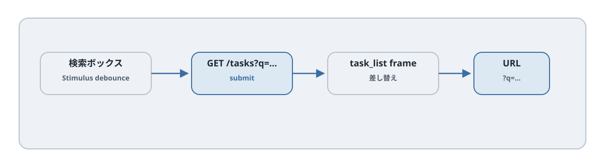

# 第23章 検索と絞り込み

## この章のねらい

第7部では、ここまでの Turbo と Stimulus を組み合わせて、実務でよく出る UI を作ります。最初は検索と絞り込みです。

この章で作るのは、入力に追従して一覧だけが絞り込まれ、しかも結果を URL で共有・リロードできる検索です。Turbo Frames が「1 か所だけを差し替える」代表例だと体得します。

> この部では、各章で次の 3 つの問いを使い回します。サーバーの状態が要るか／更新は 1 か所か複数か／きっかけは誰か。検索は「サーバーの状態が要る・更新は一覧 1 か所・きっかけは自分」なので、Turbo Frames が向きます。

## 23.1 完成イメージ

タスク一覧の上部に、検索ボックスとステータスの絞り込みを置きます。文字を入力すると、少し待って一覧だけが絞り込まれます。`/tasks?q=...&status=...` のように URL にも条件が反映され、その URL を共有・リロードしても同じ結果が出ます。

## 23.2 この章の選択

更新したいのは一覧の 1 か所だけです。だから Turbo Frames を使います。検索フォームは状態を変えない読み取りなので、GET です（第8章）。入力への追従は、サーバー往復の要らない部分なので Stimulus が担います。

## 23.3 絞り込みを一か所にまとめる

`TasksController` の `private` 節へ `filtered_tasks` を置きます。SQLite で `%` と `_` を普通の文字として検索するには、`sanitize_sql_like` と明示的な `ESCAPE` の両方が必要です。SQL の値はバインドします。

```ruby
def filtered_tasks
  scope = Task.includes(:assignee, :tags).order(id: :desc)
  if params[:q].present?
    scope = scope.where("title LIKE ? ESCAPE ?", "%#{Task.sanitize_sql_like(params[:q])}%", "\\")
  end
  scope = scope.where(status: params[:status]) if params[:status].present?
  scope = scope.where(project_id: params[:project_id]) if params[:project_id].present?
  scope = scope.joins(:taggings).where(taggings: { tag_id: params[:tag_id] }).distinct if params[:tag_id].present?
  scope
end
```

この章の `index` は `@task = Task.new`、`@tasks = filtered_tasks`、`@total_count = @tasks.count` を用意します。第24章でページ分割を加えます。

タグ編集には `_form` に `form.collection_check_boxes :tag_ids, Tag.order(:name), :id, :name` を追加し、`task_params` に `tag_ids: []` を許可します。`fieldset` と `legend` でタグ群に名前を付けます。タグ自体の作成 UI は対象外で、seed のタグから選びます。

## 23.4 一覧を frame で囲む

一覧だけを差し替えるために、結果を frame で囲みます。

`app/views/tasks/index.html.erb`（抜粋）

```erb
<%= form_with url: tasks_path, method: :get, data: { turbo_frame: "task_list" } do |form| %>
  <%= form.label :q, "タイトルで検索" %>
  <%= form.search_field :q, value: params[:q] %>
  <%= form.label :status, "ステータス" %>
  <%= form.select :status, Task.statuses.keys, { include_blank: "すべて", selected: params[:status] } %>
  <%= form.submit "検索" %>
<% end %>

<%= turbo_frame_tag "task_list" do %>
  <%= render "tasks", tasks: @tasks %>
<% end %>
```

フォームに `data-turbo-frame="task_list"` を付けました。これで、検索の GET は `id="task_list"` の frame だけを差し替えます（第11章）。`index` のレスポンスにも同じ frame があるので、結果の部分だけが入れ替わります。検索ボックスやヘッダーは動きません。

## 23.5 Stimulus で requestSubmit を debounce する




「検索」ボタンを押さなくても、入力に追従して絞り込みたいところです。Stimulus で、入力のたびにフォームを送信します。ただし、1 文字ごとに送るとリクエストが多すぎるので、少し待ってから送る（debounce）ようにします。

`app/javascript/controllers/search_controller.js`

`app/javascript/controllers/search_controller.js`

```javascript
{{#include ../snippets/app/javascript/controllers/search_controller.js}}
```


フォームにコントローラと action を付けます。

```erb
<%= form_with url: tasks_path, method: :get,
      data: { turbo_frame: "task_list", controller: "search",
              action: "input->search#submit change->search#submit compositionstart->search#startComposition compositionend->search#endComposition" } do |form| %>
```

action は form 要素に付けているので、子要素から伝わってくるイベントを拾います。ここで、要素によって発火するイベントが違う点に注意します。検索ボックスのテキスト入力は `input` イベント、ステータスの `<select>` は `change` イベントで変化します。どちらも拾えるように、`input` と `change` の 2 つを指定しています。どちらが起きても `submit` が呼ばれ、300 ミリ秒待ってから `this.element.requestSubmit()` でフォームを送信します。`requestSubmit()` は、ボタンを押したのと同じようにフォームを送り、Turbo がそれを横取りして frame を差し替えます。待ち時間は Values で持たせているので（第21章）、HTML 側から変えられます。

## 23.6 `data-turbo-action="replace"` で現在の履歴を更新する

ここまでで一覧は絞り込めますが、1 つ問題があります。frame の差し替えでは URL が変わりません（第11章）。検索結果を共有・リロードできるようにするには、URL に条件を反映させる必要があります。

frame に `data-turbo-action="replace"` を付けます。

```erb
<%= turbo_frame_tag "task_list", data: { turbo_action: "replace" } do %>
  <%= render "tasks", tasks: @tasks %>
<% end %>
```

`replace` を付けると、frame の差し替えに合わせてブラウザの URL も更新されます。`/tasks?q=bug&status=todo` のような URL になり、共有・リロード・再読み込みで検索結果を取得できます。入力のたびに戻る履歴を増やさないため `replace` を選びます。検索条件が URL に残るので、誰かに送れば同じ結果が再現できます。

## 23.7 フレーム外を更新したくなったときの判断

「検索結果の件数も出したい」となったとき、件数バッジを frame の外に置くと、frame の差し替えでは更新できません（第14章）。一覧という 1 か所だけを差し替えているからです。

選択肢は 2 つです。

- 件数バッジを `task_list` frame の<strong>中</strong>に置く。こうすれば、結果と一緒に更新されます。検索の範囲では、これがいちばん素直です。
- どうしても frame の外（離れた場所）に件数を置きたいなら、Turbo Streams へ切り替えます（第5部）。複数箇所の同時更新は Streams の領分です。

まずは frame の中に収める。収まらなくなったら Streams を検討する。この判断軸（第14章）が、ここでも効きます。

## 23.8 a11y

検索は、目で見ているユーザーには自然ですが、配慮が要ります。

- 結果全体ではなく件数の短い文に `role="status"` を付けます。一覧の全文を毎回読み上げないためです。件数（「3 件見つかりました」など）を結果の中に出すと、より親切です。
- 入力に追従して送信するので、フォーカスは検索ボックスに留めます。`requestSubmit()` はフォーカスを動かさないので、入力を続けられます。

```erb
<%= turbo_frame_tag "task_list", data: { turbo_action: "replace" } do %>
  <p role="status"><%= @total_count %> 件該当</p>
  <%= render "tasks", tasks: @tasks %>
<% end %>
```

## 23.9 テスト

検索は、System Test と Request Test で役割を分けて確かめます。

- System Test … 入力すると一覧が絞り込まれる、という「画面の振る舞い」を確かめます。Stimulus の debounce や frame の差し替えを含みます。
- Request Test … パラメータに対して、コントローラが正しい結果を返すという「サーバーの絞り込み」を確かめます。`get tasks_path(q: "bug")` で、期待する件数・内容になるかを見ます。

System Test だけだと、絞り込み条件の網羅が重くなります。条件の組み合わせは Request Test で、画面の追従は System Test で、と分けると、軽く確実にテストできます。

## 23.10 アンチパターン

- <strong>debounce なし</strong>。1 文字ごとに送ると、リクエストが大量に飛びます。必ず待ちを入れます。
- <strong>URL に条件を残さない</strong>。frame の差し替えだけで `replace` を付けないと、共有もリロードもできません。
- <strong>単一箇所なのに Streams で全置換</strong>。一覧 1 か所の更新なら frame で十分です。なんでも Streams にすると、かえって複雑になります。

> 第23章では、検索を Turbo Frames＋Stimulus で作り、URL に条件を残しました。次の [第24章](chapter24.md) では、件数の多い一覧を扱うページネーションと無限スクロールを学びます。

## 23.11 CRUD・broadcast と検索を統合する

第17章の `@tasks` を使う直接置換はここで終了します。POST に GET の検索条件が自動で引き継がれることはありません。第18章の変更通知方式を有効にし、一覧を自分の URL で取得し直します。作成・削除で空状態と件数も更新できます。

完成版のコントローラと一覧は第24章に掲載します。検索・タグ・ページ分割・更新通知を併用する場合は、その組で置き換えてください。新規フォームはフレームの外に置き、一覧を取得し直しても入力内容が消えないようにします。

## 参考資料

- Turbo Frames（Handbook）: <https://turbo.hotwired.dev/handbook/frames>
- Turbo の属性リファレンス: <https://turbo.hotwired.dev/reference/attributes>
- Stimulus リファレンス（Actions / Values）: <https://stimulus.hotwired.dev/reference/actions>
- MDN: ARIA live regions: <https://developer.mozilla.org/en-US/docs/Web/Accessibility/ARIA/ARIA_Live_Regions>
