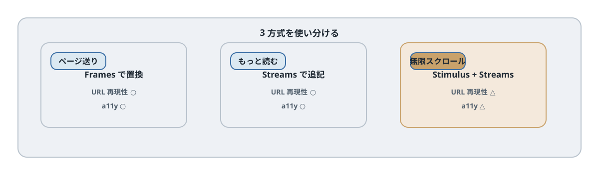

# 第24章 ページネーションと無限スクロール

## この章のねらい

タスクが増えると、一覧を一度に全部出すわけにはいきません。この章では、件数の多い一覧を分割して見せる方法を、3 段階で学びます。

通常のページネーション、「もっと読む」ボタンによる追加読み込み、そして無限スクロールです。それぞれに向き不向きがあり、どの Hotwire の道具を使うかも変わります。

## 24.1 完成イメージ

- ページ送り … `?page=2` のようにページを切り替える、いちばん基本的な形
- もっと読む … ボタンを押すと、続きが一覧の末尾に追加される形
- 無限スクロール … 一覧の末尾までスクロールすると、自動で続きが読み込まれる形

下に行くほど「途切れず読める」一方で、操作性やアクセシビリティの注意が増えます。

## 24.2 この章の選択

3 段階で、使う道具が変わります。

- ページ送りは、一覧を別ページの内容で<strong>置換</strong>します。Turbo Frames が向きます。
- もっと読むは、続きを末尾に<strong>追記</strong>します。Turbo Streams の `append` が向きます。
- 無限スクロールは、「末尾が見えた」ことを<strong>検知</strong>して、もっと読むを自動で押します。検知は Stimulus が担います。

置換は Frames、追記は Streams、検知は Stimulus。第7部の判断軸が、ここでも効きます。




## 24.3 通常のページネーションを作る

まず、サーバー側でページごとに区切ります。ここでは仕組みを示すため手で書きますが、実務では Pagy や Kaminari などの gem を使うのが普通です。

`app/controllers/tasks_controller.rb`（`index`。`PER_PAGE` はコントローラのクラス定数として定義しておきます）

```ruby
PER_PAGE = 20

def index
  @page = [params[:page].to_i, 1].max
  @task = Task.new
  scope = filtered_tasks
  @total_count = scope.count
  @tasks = scope.offset((@page - 1) * PER_PAGE).limit(PER_PAGE)
  @next_page = @page + 1 if scope.count > @page * PER_PAGE
end
```

`@next_page` は、次のページがあるときだけ値が入ります。最終ページでは `nil` です。

ビューでは、一覧と「次へ」のリンクを出します。

```erb
<div id="tasks">
  <%= render @tasks %>
</div>

<% if @next_page %>
  <%= link_to "次へ", tasks_path(request.query_parameters.merge(page: @next_page)) %>
<% end %>
```

この時点では、ページを切り替えるとページ全体が visit されます。

## 24.4 Frame 内ページネーションと `data-turbo-action`

一覧とページ送りだけを差し替えるために、frame で囲みます。第23章の検索と同じ考え方です。

```erb
<%= turbo_frame_tag "task_list", data: { turbo_action: "advance" } do %>
  <div id="tasks">
    <%= render @tasks %>
  </div>

  <% if @next_page %>
    <%= link_to "次へ", tasks_path(request.query_parameters.merge(page: @next_page)) %>
  <% end %>
<% end %>
```

ページ送りのリンクは frame の中にあるので、クリックすると `task_list` frame だけが次ページの内容に置き換わります。`data-turbo-action="advance"` を付けてあるので、URL も `?page=2` に変わり、リロードや共有、戻る操作に耐えます。

これが「置換」型のページネーションです。一覧をまるごと次ページに置き換えます。

## 24.5 「もっと読む」ボタンで append を使う

次は「追記」型です。ページを置き換えるのではなく、続きを末尾に足します。

「もっと読む」リンクを、Turbo Streams で応答させます。第15章で見たとおり、GET でも `data-turbo-stream` を付ければ Turbo Streams を受け取れます。

```erb
<div id="tasks">
  <%= render @tasks %>
</div>

<div id="pagination">
  <% if @next_page %>
    <%= link_to "もっと読む", tasks_path(request.query_parameters.merge(page: @next_page)), data: { turbo_stream: true, infinite_scroll_target: "button" } %>
  <% end %>
</div>
```

コントローラは、`turbo_stream` 形式に応答します。

`app/controllers/tasks_controller.rb`（`index` に追記）

```ruby
respond_to do |format|
  format.html
  format.turbo_stream
end
```

`app/views/tasks/index.turbo_stream.erb`

```erb
<%= turbo_stream.append "tasks", partial: "tasks/task", collection: @tasks %>
<%= turbo_stream.update "pagination" do %>
  <% if @next_page %>
    <%= link_to "もっと読む", tasks_path(request.query_parameters.merge(page: @next_page)), data: { turbo_stream: true, infinite_scroll_target: "button" } %>
  <% end %>
<% end %>
```

「もっと読む」を押すと、次ページのタスクが `id="tasks"` の末尾に `append` され、ボタン自体は次ページ用のボタンに `update` されます。最終ページでは `@next_page` が `nil` なので、ボタンが消えます。一覧は置き換わらず、下に伸びていきます。

## 24.6 IntersectionObserver で自動化する

無限スクロールは、この「もっと読む」を自動で押す形です。末尾が画面に見えたことを検知して、ボタンをクリックします。検知には、ブラウザの `IntersectionObserver` を使います。これを Stimulus コントローラで包みます。

`app/javascript/controllers/infinite_scroll_controller.js`

`app/javascript/controllers/infinite_scroll_controller.js`

```javascript
{{#include ../snippets/app/javascript/controllers/infinite_scroll_controller.js}}
```


`buttonTargetConnected` は初回の `connect` より先に呼ばれます。そのため observer は `initialize` で作ります。新旧のリンクを同じ partial から描き、更新後にも target 属性を残します。

ここがこの章の肝です。「もっと読む」を押すと、24.5 のとおり `update "pagination"` でボタンが新しい要素に差し替わります。もし `connect()` で最初のボタンだけを監視していると、差し替え後は削除済みの旧ボタンを見続け、2 回目以降が発火しません。そこで、ターゲットが差し替わるたびに呼ばれる `buttonTargetConnected` / `buttonTargetDisconnected` を使い、新しいボタンを監視し直します。最終ページでボタンが消えれば、`buttonTargetDisconnected` で監視が外れ、自動読み込みも止まります。

```erb
<div id="pagination" data-controller="infinite-scroll">
  <% if @next_page %>
    <%= link_to "もっと読む", tasks_path(request.query_parameters.merge(page: @next_page)),
          data: { turbo_stream: true, infinite_scroll_target: "button" } %>
  <% end %>
</div>
```

ここで `data-controller` の値に注意します。ファイル名は `infinite_scroll_controller.js` ですが、識別子はアンダースコアがハイフンになり `infinite-scroll` です（第19章）。`data-controller` の値は変換されないので、`"infinite-scroll"` と書きます。一方、ターゲットの `data: { infinite_scroll_target: "button" }` は、Rails が属性名を `data-infinite-scroll-target` に変換するので、そのままで `infinite-scroll` コントローラのターゲットになります。

「もっと読む」ボタンが画面に見えると、`IntersectionObserver` が検知し、ボタンを `click()` します。クリックは 24.5 の append を起こすので、続きが自動で読み込まれます。`disconnect()` で監視を解除するのを忘れないでください（第22章）。

## 24.7 ボタンを残す理由

無限スクロールでも、24.6 のように<strong>「もっと読む」ボタンを土台に残す</strong>ことを勧めます。自動読み込みは、その上に乗せる「おまけ」と考えます。

理由はアクセシビリティです。純粋な無限スクロールは、キーボードだけで操作するユーザーや、スクリーンリーダーのユーザーには扱いにくいものです。ボタンがあれば、スクロールに頼らず続きを読めますし、フォーカスも当てられます。自動読み込みは便利ですが、ボタンという確実な手段を奪ってはいけません。

## 24.8 URL とスクロール位置

追記型・無限スクロールには、URL とスクロール位置の弱点があります。

ページ送り（24.4）は `?page=2` が URL に残るので、リロードや共有で同じ位置に戻れます。一方、もっと読む・無限スクロールは、下に伸ばしているだけなので、リロードすると最初のページに戻ります。また、詳細へ移動してから戻ると、読み込んだ続きやスクロール位置が失われがちです。

「途切れず読める」ことと「URL で位置を再現できる」ことは、トレードオフです。共有・リロードを重視する一覧はページ送りに、流し読みを重視する一覧は追記型に、と使い分けます。

## 24.9 テスト

ページネーションのテストでは、次の 2 点を特に確かめます。

- <strong>追記に重複がないこと</strong>。「もっと読む」を押したとき、すでに表示済みのタスクが二重に出ないか。
- <strong>最終ページの終端</strong>。最後まで読み込んだら、「もっと読む」が消えるか。

System Test で、もっと読むを押して件数が増えること、最後にボタンが消えることを確認します。境界（ちょうど割り切れる件数、1 ページに満たない件数）も見ておくと安心です。

## 24.10 アンチパターン

- <strong>フッターに永遠に到達できない</strong>。無限スクロールで、ページ下部のフッターやリンクに、いつまでもたどり着けなくなる。
- <strong>戻ると位置が失われる</strong>。詳細から戻ったとき、読み込んだ続きやスクロール位置が消える。
- <strong>監視の解除漏れ</strong>。`IntersectionObserver` を `disconnect()` で解除せず、二重に読み込む。

> 第24章では、ページネーションを置換・追記・検知の 3 段階で作り分けました。次の第25章では、フォームのバリデーションエラーと、その UX を扱います。第8章で予告した 422 の契約を、ここで本格的に使います。

## 24.11 完成版への置き換え

ここまでのページ送り・追記型・自動読み込みは、同じ場所へ重ねて追加するコードではなく、表示方式の選択肢です。完成版では `mode=pages` / `more` / `infinite` で切り替えます。以下は第23章の検索、CRUD、モーダルの分岐も含む統合版です。第25・26章ではフォームとモーダル側を読み解きます。

`app/controllers/tasks_controller.rb`

```ruby
{{#include ../snippets/app/controllers/tasks_controller.rb}}
```
`app/views/tasks/index.html.erb`

```erb
{{#include ../snippets/app/views/tasks/index.html.erb}}
```
`app/views/tasks/_pagination.html.erb`

```erb
{{#include ../snippets/app/views/tasks/_pagination.html.erb}}
```
`app/views/tasks/index.turbo_stream.erb`

```erb
{{#include ../snippets/app/views/tasks/index.turbo_stream.erb}}
```
`app/views/tasks/create.turbo_stream.erb`

```erb
{{#include ../snippets/app/views/tasks/create.turbo_stream.erb}}
```
`app/views/tasks/update.turbo_stream.erb`

```erb
{{#include ../snippets/app/views/tasks/update.turbo_stream.erb}}
```
`app/views/tasks/destroy.turbo_stream.erb`

```erb
{{#include ../snippets/app/views/tasks/destroy.turbo_stream.erb}}
```

`@total_count` は全該当件数、`@paged_tasks` は現在のページの行です。変更通知後は一覧フレームを再取得し、件数・空状態・次ページの有無を同じ条件で再計算します。編集中と追記モードでは自動で全置換せず通知を出します。

offset 型は読み込みの途中でレコードが増減するとページ境界が動きます。静止したデータでの重複防止テストと、同時更新時の順序保証は別です。本番で厳密な連続性が必要ならカーソル型を検討します。

## 参考資料

- Turbo Frames（Handbook）: <https://turbo.hotwired.dev/handbook/frames>
- Turbo Streams リファレンス: <https://turbo.hotwired.dev/reference/streams>
- Stimulus（Building Something Real）: <https://stimulus.hotwired.dev/handbook/building-something-real>
- MDN: IntersectionObserver: <https://developer.mozilla.org/en-US/docs/Web/API/Intersection_Observer_API>
