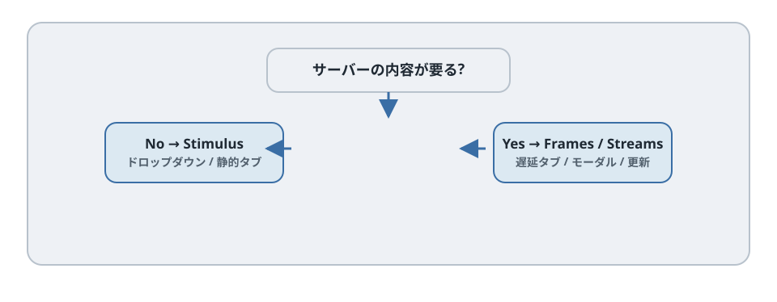
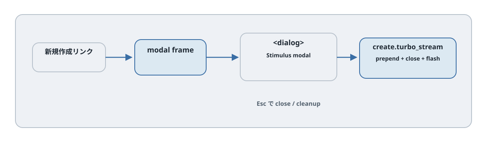

# 第26章 モーダル、タブ、ドロップダウン

## この章のねらい

モーダル、タブ、ドロップダウン。どれも見慣れた UI ですが、Hotwire では「何で作るか」が一つに決まりません。サーバーの内容が要るかどうかで、実装が分かれるからです。

この章では、その仕分けを学びます。サーバーの内容が要らないものは Stimulus だけで、サーバーから内容を取るものは Turbo Frames や Turbo Streams で作ります。

## 26.1 完成イメージ

- ドロップダウン … ボタンを押すとメニューが開く。中身は最初からある
- タブ … 切り替えで表示が変わる。中身が最初からある「静的タブ」と、開いたときにサーバーから取る「遅延タブ」がある
- モーダル … 「新規作成」を押すと、サーバーからフォームを取って重ねて表示する

## 26.2 この章の選択

判断の軸は「サーバーの状態（内容）が要るか」です。

- ドロップダウンや静的タブは、中身が最初からページにあります。開閉や切り替えはサーバー往復が要りません。だから Stimulus だけで作ります。
- 遅延タブやモーダルは、中身をサーバーから取ります。だから Turbo Frames や Turbo Streams を使います。

同じ「重ねて表示する」見た目でも、中身がどこから来るかで道具が変わります。




## 26.3 ドロップダウンを Stimulus だけで作る

ドロップダウンは、サーバーと関係ありません。Stimulus だけで作ります。

`app/javascript/controllers/dropdown_controller.js`

`app/javascript/controllers/dropdown_controller.js`

```javascript
{{#include ../snippets/app/javascript/controllers/dropdown_controller.js}}
```


```erb
<div data-controller="dropdown" data-action="click@window->dropdown#close keydown.esc@window->dropdown#close">
  <button type="button" data-dropdown-target="button" data-action="dropdown#toggle"
          aria-expanded="false">メニュー</button>
  <ul data-dropdown-target="menu" hidden>
    <li>...</li>
  </ul>
</div>
```

`toggle` でメニューの表示を切り替え、あわせて開閉状態を `aria-expanded` に反映します。`click@window->dropdown#close` で、外側をクリックしたときに閉じます（`@window` は window で起きたイベントを拾う書き方です）。サーバーへの問い合わせは一切ありません。

## 26.4 静的タブを Stimulus だけで作る

中身が最初からページにあるタブも、Stimulus だけで作れます。選ばれたタブのパネルを表示し、ほかを隠すだけです。

このとき、アクセシビリティのために、タブには適切な役割（role）を付けます。`tablist`・`tab`・`tabpanel` です。これは 26.8 でまとめて扱います。中身がすでにあるので、切り替えはサーバーと無関係で、Stimulus が表示を出し入れします。

## 26.5 遅延タブを Turbo Frames で読み込む

タブの中身が重い、あるいは最初は要らない場合は、開いたときにサーバーから取ります。これは第13章で見た遅延読み込みです。

タブのリンクで、共通の content frame を差し替えます。

```erb
<nav aria-label="プロジェクト内の表示">
  <%= link_to "概要", overview_project_path(@project), data: { turbo_frame: "tab_content" } %>
  <%= link_to "タスク", tasklist_project_path(@project), data: { turbo_frame: "tab_content" } %>
</nav>

<%= turbo_frame_tag "tab_content" do %>
  <p>タブを選んでください。</p>
<% end %>
```

この遅延表示は通常のリンクナビゲーションとして実装し、ARIA の tab ロールは付けません。tab を名乗るには選択状態や矢印キー操作も必要だからです。各リンクの行き先が `id="tab_content"` の frame を返します（第13章）。中身をサーバーから取るので、Stimulus 単独ではなく Turbo Frames です。

## 26.6 モーダルを Turbo Frames と `<dialog>` で作る




モーダルは、サーバーからフォームを取って重ねます。Turbo Frames で内容を取り、`<dialog>` 要素で重ねて表示します。

まず、レイアウトに空のモーダル用 frame を置きます。

```erb
<%= turbo_frame_tag "modal" %>
```

「新規作成」リンクで、この frame を差し替えます。

```erb
<%= link_to "新規作成", new_task_path, data: { turbo_frame: "modal" } %>
```

`new.html.erb` は、`id="modal"` の frame の中に `<dialog>` を置き、Stimulus で開きます。

`app/views/tasks/new.html.erb`

```erb
{{#include ../snippets/app/views/tasks/new.html.erb}}
```
`app/javascript/controllers/modal_controller.js`

```javascript
{{#include ../snippets/app/javascript/controllers/modal_controller.js}}
```

`turbo_frame_request_id == "modal"` のときだけ modal frame を返します。URL を直接開いたときは普通のフォームを返すため、レイアウトの空 frame と ID が重複しません。起点のリンクには `id: "new_task_modal_link"` を付けます。dialog の削除後は、このリンクへフォーカスを戻します。

エラー時も `modal` frame を HTML 422 で返す必要があります。第24章の `create` はその分岐を inline より先に判定します。inline 用の `new_task_form` だけを更新すると、モーダルのエラーが見えません。

## 26.7 成功時に Streams でモーダルを空にする

モーダルの中のフォームを送信して成功したら、モーダルを閉じ、一覧を更新します。これは複数箇所の更新なので、Turbo Streams です（第16章）。

`app/views/tasks/create.turbo_stream.erb`（成功時）

`app/views/tasks/create.turbo_stream.erb`

```erb
{{#include ../snippets/app/views/tasks/create.turbo_stream.erb}}
```

モーダルを空にし、フォームとフラッシュを更新してから一覧の変更通知を渡します。検索条件に合わない行を無条件で追加しません。失敗時はモーダル内のフォームへエラーを返します。

## 26.8 a11y

モーダルとタブは、アクセシビリティの作り込みが要ります。

- <strong>モーダル</strong>。`<dialog>` を `showModal()` で開くと、フォーカスがダイアログ内に閉じ込められ（focus trap）、`Esc` で閉じられ、開閉に伴うフォーカスの移動も、ブラウザがかなり面倒を見てくれます。これが、`<div>` で自作せず `<dialog>` を使う理由です。自作すると、focus trap も Esc も自分で実装することになり、抜けが出ます。
- <strong>タブ</strong>。`role="tablist"`・`role="tab"`・`role="tabpanel"` を付け、選択中のタブを `aria-selected="true"` にします。矢印キーでの移動なども、タブの標準的な振る舞いです。
- <strong>ドロップダウン</strong>。開閉ボタンに `aria-expanded` を付け、`Esc` で閉じ、キーボードで項目をたどれるようにします。

## 26.9 URL: モーダルをディープリンクにするか

モーダルには、URL の設計判断があります。`/tasks/new` を開いた状態を URL に残す（ディープリンク）か、残さないかです。

残さない場合は、26.6 のように frame の差し替えだけで開きます（URL は変わりません）。手軽ですが、モーダルを開いた URL を共有・リロードで再現できません。残したい場合は、第14章の `data-turbo-action="advance"` を使い、モーダルを開く遷移を URL に積みます。

多くのモーダル（作成・編集など）は、ディープリンクが不要です。まずは URL を変えない素朴な形から始め、共有が必要になったら advance を検討します。

## 26.10 テスト

モーダルは、System Test で次を確かめます。

- 「新規作成」で開く
- `Esc` で閉じる
- 送信に成功すると、モーダルが閉じ、一覧にタスクが追加される

ドロップダウンやタブは、開閉・切り替えと、開いていないときに中身が見えないことを確認します。

## 26.11 アンチパターン

- <strong>モーダルの乱用</strong>。何でもモーダルにすると、URL が機能しなくなり、戻る操作も効かなくなります。
- <strong>`<div>` で自作してキーボード操作が壊れる</strong>。focus trap や Esc を自前で作ると、抜けが出ます。`<dialog>` を使います。
- <strong>Stimulus でサーバー内容を二重管理する</strong>。サーバーから取れる内容を、Stimulus 側でも持とうとすると、ずれます。サーバー内容が要るなら Frames / Streams に任せます。

> 第26章では、サーバー内容の要否で UI の作り方を仕分けました。次の第27章では、通知・トースト・フラッシュを題材に、Turbo Streams・Stimulus・Action Cable の合わせ技で第7部を締めます。

## 26.12 遅延表示のルートとビュー

第13章の `resources :projects` の member に `get :overview` と `get :tasklist` を追加します。コントローラの `set_project` の対象にも二つのアクションを追加します。

```ruby
def overview; end

def tasklist
  @tasks = @project.tasks.includes(:assignee, :tags).order(id: :desc)
end
```

`overview.html.erb` は `turbo_frame_tag "tab_content"` で `@project.description` を囲み、`tasklist.html.erb` は同じ frame の中で `render @tasks` を呼びます。プロジェクト詳細に第13章の別のタスク一覧を同時に置くと `task_1` などが重複するため、完成版では遅延ナビゲーションの一か所だけへ表示します。

## 26.13 静的タブの完全な例

静的タブは次のコントローラで選択状態・tabindex・パネル表示を一緒に変更します。左右矢印・Home・End に対応します。ID の接頭辞は同じページで重複しないものを使います。

`app/javascript/controllers/tabs_controller.js`

```javascript
{{#include ../snippets/app/javascript/controllers/tabs_controller.js}}
```

```html
<div data-controller="tabs">
  <div role="tablist" aria-label="説明" data-action="keydown->tabs#navigate">
    <button type="button" id="help-tab-a" role="tab" aria-controls="help-panel-a" aria-selected="true" tabindex="0" data-tabs-target="tab" data-action="tabs#select">概要</button>
    <button type="button" id="help-tab-b" role="tab" aria-controls="help-panel-b" aria-selected="false" tabindex="-1" data-tabs-target="tab" data-action="tabs#select">操作</button>
  </div>
  <div id="help-panel-a" role="tabpanel" aria-labelledby="help-tab-a" tabindex="0" data-tabs-target="panel">概要の本文</div>
  <div id="help-panel-b" role="tabpanel" aria-labelledby="help-tab-b" tabindex="0" data-tabs-target="panel" hidden>操作の本文</div>
</div>
```

ドロップダウン例は、通常のリンク一覧を開閉する disclosure として扱います。`aria-haspopup="menu"` や menu ロールは付けません。メニュー型にするなら矢印キーなど別のキーボード規約も実装します。

## 参考資料

- Turbo Frames（Handbook）: <https://turbo.hotwired.dev/handbook/frames>
- Turbo Streams リファレンス: <https://turbo.hotwired.dev/reference/streams>
- Stimulus リファレンス（Actions）: <https://stimulus.hotwired.dev/reference/actions>
- MDN: dialog 要素: <https://developer.mozilla.org/en-US/docs/Web/HTML/Element/dialog>
- ARIA Authoring Practices（Tabs / Menu / Dialog）: <https://www.w3.org/WAI/ARIA/apg/patterns/>
